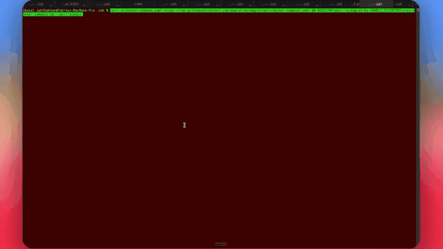
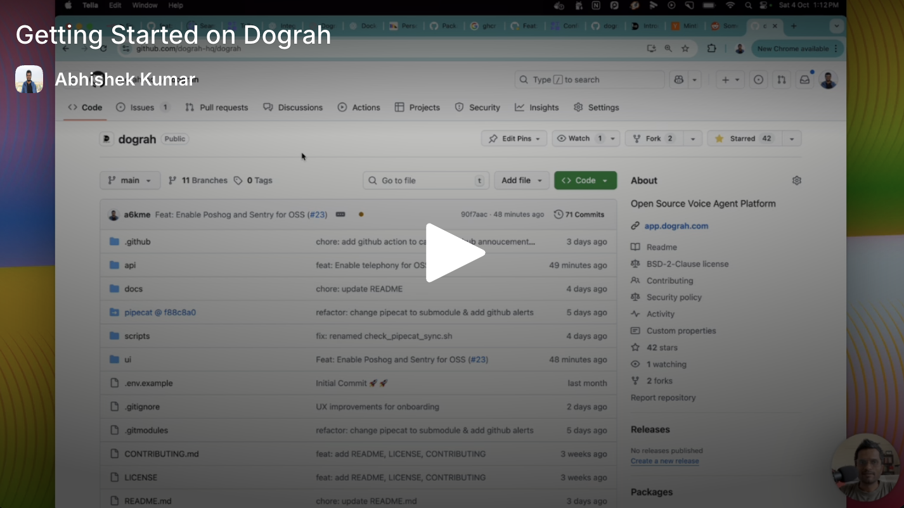

# ZuriFlow

**Voice AI built for Kenya — open source and self-hostable.** Deploy production voice agents that speak natural Swahili, English, and Sheng; collect M-Pesa payments on live calls; and run Kenya-ready workflows for fintech, collections, retail, and support. From zero to a working bot in under 2 minutes.


<p align="center">
  <a href="https://docs.dograh.com">📖 Docs</a> &nbsp;·&nbsp;
  <a href="LICENSE">📜 BSD 2-Clause</a> &nbsp;·&nbsp;
  <a href="README.zh-CN.md">🌐 中文</a>
</p>

<p align="center">
  
</p>

- **Built for Kenyan phone calls** — Swahili/English code-switching, Sheng normalization, and conversational styles that sound local, not robotic
- **M-Pesa & WhatsApp native** — STK Push during voice calls, payment receipts, and post-call follow-ups on channels Kenyans already use
- **Industry-ready templates** — Fintech support, debt collection, retail booking, and SME support with bilingual prompts and escalation rules
- **100% open source**, self-hostable — run on your own infra with full data residency; no vendor lock-in
- **Maintained by YC alumni and exit founders**, committed to keeping voice AI open and accessible in emerging markets

<p align="center">
  <a href="https://trendshift.io/repositories/31007" target="_blank"></a>
</p>

## 🎥 Featured

<div align="center">
  <a href="https://www.youtube.com/watch?v=xD9JEvfCH9k">
    
  </a>
  <br>
  <em>Featured by <strong>Better Stack</strong> — a hands-on look at ZuriFlow</em>
</div>

<details>
<summary>📺 Prefer a 2-minute product walkthrough? Click here.</summary>

<div align="center">
  <a href="https://youtu.be/9gPneyf9M9w">
    
  </a>
</div>

</details>

## ⚖️ ZuriFlow vs Vapi vs Retell

An honest comparison on the axes that matter most to teams evaluating voice AI platforms.

|  | **ZuriFlow** | **Vapi** | **Retell** |
|---|---|---|---|
| **License** | BSD 2-Clause (open source) | Proprietary | Proprietary |
| **Self-hostable** | ✅ Yes — one Docker command | ❌ SaaS only | ❌ SaaS only |
| **Swahili / Sheng / code-switching** | ✅ Built-in normalization, intent, and voice personality | ❌ Generic English-first | ❌ Generic English-first |
| **M-Pesa on voice calls** | ✅ Daraja STK Push + in-call payment flows | ❌ Not built-in | ❌ Not built-in |
| **Kenya vertical workflows** | ✅ Fintech, collections, retail, support templates | ❌ Build from scratch | ❌ Build from scratch |
| **Pricing** | Free (self-host) · usage-based (cloud) | Per-minute SaaS | Per-minute SaaS |
| **Bring your own LLM / STT / TTS** | ✅ Any provider, or use ZuriFlow's stack | Configurable within their integrations | Configurable within their integrations |
| **Source-level customization** | ✅ Every line is yours to modify | ❌ Closed source | ❌ Closed source |
| **Data residency** | Your infra, your rules | Their cloud | Their cloud |
| **Vendor lock-in** | None | Full | Full |

## 🇰🇪 Built for Kenya

ZuriFlow goes beyond generic voice AI with a full stack tuned for how Kenyans actually talk, pay, and do business on the phone.

### Voice & language

- **Bilingual agents** — English, Swahili, and natural mixed-mode responses (`en` / `sw` / `mixed`) on every call
- **Sheng & code-switch normalization** — STT transcripts are mapped through a Kenyan phrase dictionary so "nataka balance yangu" and "sawa boss" are understood reliably
- **Kenyan conversational behavior** — Local pacing, interruptions, and confirmations ("Sawa", "Poa", "Naelewa") instead of robotic call-centre scripts
- **Voice personalities** — Presets like Nairobi Professional, Friendly Receptionist, SACCO Collections Officer, and Logistics Dispatcher with tone and TTS tuning per use case
- **Realtime intent detection** — Bilingual patterns for payment, booking, escalation, and support (`lipa`, `mpesa`, `miadi`, `nataka mtu`, and more)
- **Continuous learning** — Feedback loops to improve normalization and intent from real Kenyan call data (optional)
- **Accent detection** — Optional speaker accent classification for analytics and routing (requires extra ML deps)

### Payments & channels

- **M-Pesa Daraja** — Safaricom STK Push, callbacks, retries, and transaction tracking per organization
- **Voice M-Pesa** — Collect payments mid-call: confirm amount, trigger STK Push, wait for callback, and speak the result back to the caller
- **WhatsApp follow-ups** — Send payment receipts and post-call messages after successful workflows
- **Customer timeline** — Unified view of calls, M-Pesa payments, WhatsApp messages, and workflow events per customer

### Kenya-ready workflows

- **Agent wizard** — Start from Kenya-focused industries: Fintech & Mobile Money, Collections & Recovery, Retail, Healthcare, Hospitality, and general SME support
- **Vertical templates** — Pre-built flows for fintech support, debt collection (with compliance rules), and retail booking — each wired for M-Pesa, escalation, and bilingual prompts
- **Debt collection** — Polite multilingual negotiation, installment scheduling, M-Pesa collection, and human escalation with audit trails
- **Call routing & escalation** — Route by intent, queue human agents, and hand off when confidence is low or the caller asks for a person
- **Durable orchestration** — Post-call journeys (e.g. payment wait, WhatsApp receipt) with retries and compensation

### Production on Kenyan mobile networks

- **Kenya production mode** (`KENYA_PRODUCTION_MODE=true`) — Tighter audio/LLM/TTS buffers and VAD tuning for GSM latency and mobile data
- **Low-latency voice pipeline** — Optimized end-to-end targets for real phone lines, not just low-latency datacenter demos
- **Self-hosted deployment** — Run entirely in Kenya (on-prem Kubernetes assets under `infra/on-prem/`) with optional local GPU inference

Enable Kenya features in `api/.env` (most language and workflow modules are on by default):

```bash
KENYAN_NORMALIZE_ENABLED=true
KENYAN_INTENT_ENABLED=true
KENYAN_VOICE_PERSONALITY_ENABLED=true
MPESA_ENABLED=true          # configure Daraja credentials per org in the UI
VOICE_MPESA_ENABLED=true
WHATSAPP_ENABLED=true       # configure Meta/WhatsApp per org
KENYA_PRODUCTION_MODE=false # set true for production mobile tuning
```

## 🚀 Get Started

##### Download and setup ZuriFlow on your local machine

> **Note**
> We collect anonymous usage data to improve the product. You can opt out by setting `ENABLE_TELEMETRY=false` before running the startup script.

> **Note**
> If you wish to run the platform on a remote server instead, checkout our [Documentation](https://docs.dograh.com/deployment/docker#option-2:-remote-server-deployment)

```bash
curl -o docker-compose.yaml https://raw.githubusercontent.com/dograh-hq/dograh/main/docker-compose.yaml && curl -o start_docker.sh https://raw.githubusercontent.com/dograh-hq/dograh/main/scripts/start_docker.sh && chmod +x start_docker.sh && ./start_docker.sh
```

> **⚡ Prefer an AI agent to set it up for you?**
> If you use **Claude Code** or **Codex**, install the official [ZuriFlow setup skill](https://github.com/dograh-hq/dograh-plugins) and let your agent handle installation, configuration, and troubleshooting — it detects your OS, picks the right deploy path, runs the project's setup scripts, and verifies the result.
>
> ```text
> # In Claude Code
> /plugin marketplace add dograh-hq/dograh-plugins
> /plugin install dograh@dograh
> ```
>
> Then start a new session and ask it to _"set up ZuriFlow"_ (or run `/dograh-setup`). Codex is supported too — see the [plugin repo](https://github.com/dograh-hq/dograh-plugins#install).

> **Note**
> First startup may take 2-3 minutes to download all images. Once running, open http://localhost:3010 to create your first AI voice assistant!
> For common issues and solutions, see 🔧 **[Troubleshooting](docs/troubleshooting.md)**.

### 🎙️ Your First Voice Bot

1. Open [http://localhost:3010](http://localhost:3010) in your browser.
2. Pick **Inbound** or **Outbound**, choose a Kenya-ready industry (e.g. _Fintech & Mobile Money_ or _Collections & Recovery_), and describe the use case (e.g. _Help callers check balance and pay via M-Pesa in Swahili or English_).
3. Click **Web Call** — you're talking to your bot.

> 🔑 **No API keys needed** to start. ZuriFlow ships with auto-generated keys and its own LLM / TTS / STT stack. Add Daraja M-Pesa, WhatsApp, and telephony credentials (Twilio, Vonage, Telnyx, etc.) when you're ready for production calls.

## Features

### Voice Capabilities

- **Kenyan multilingual voice** — English, Swahili, and mixed-mode agents with local conversational style
- **Telephony** — Twilio, Vonage, Vobiz, Cloudonix, and more, with DTMF, IVR navigation, failover, and human transfer
- **Custom models** — Bring your own LLM / TTS / STT, or use ZuriFlow's managed stack
- **Real-time processing** — Low-latency pipelines tuned for mobile networks (`KENYA_PRODUCTION_MODE`)

### Payments, CRM & operations

- **M-Pesa & voice payments** — Daraja integration and in-call STK Push flows
- **WhatsApp** — Post-call receipts and customer messaging
- **Customer CRM & timeline** — Directory, phone lookup, profiles, and unified activity history
- **Operator dashboards** — Escalations, debt collection, call reliability, and conversation quality
- **Platform ops** — Event bus, durable orchestration, DLQ replay, and observability

### Developer Experience

- Zero Config Start: Auto-generated API keys for instant testing
- Python-Based: Built on Python for easy customization
- Docker-First: Containerized for consistent deployments
- Modular Architecture: Swap components as needed

### Testing & Quality

- **Test Mode**: Try your agent end-to-end before publishing, with no production calls or data affected
- **In-Dashboard Web Calls**: Talk to your bot directly while building — no telephony setup required
- **QA Node**: A built-in workflow node that analyzes prompt quality across your other nodes

## Deployment Options

### Local Development

For contributor setup, see the [Local Setup guide](https://docs.dograh.com/contribution/setup).

Quick start on your machine:

```bash
# 1. Bootstrap fork, venv, and env files
bash scripts/setup_fork.sh
source venv/bin/activate

# 2. Start Postgres, Redis, and MinIO
docker compose -f docker-compose-local.yaml up -d

# 3. Install dependencies and run migrations
bash scripts/setup_requirements.sh --dev
PYTHONPATH=. python -m alembic -c api/alembic.ini upgrade head

# 4. Start backend (API on :8000)
bash scripts/start_services_dev.sh

# 5. In another terminal, start the UI (on :3000)
cd ui && npm install && npm run dev -- --hostname 0.0.0.0
```

Open [http://localhost:3000](http://localhost:3000) and verify the API at [http://localhost:8000/api/v1/health](http://localhost:8000/api/v1/health).

#### Authentication (local dev)

Self-hosted ZuriFlow uses **local email/password auth** by default (`AUTH_PROVIDER=local`). No external auth service is required.

| Role | How to get it |
|------|----------------|
| **Org owner** | Sign up at `/auth/signup`. The first user in a new organization is assigned the owner role automatically. |
| **Superadmin** | After signing up, promote your user in Postgres: `UPDATE users SET is_superuser = true WHERE email = 'you@example.com';` then log out and back in. Superadmins can access `/superadmin` and cross-org APIs. |

